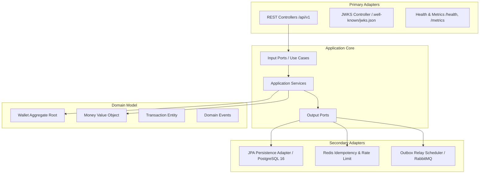

# Wallet API

[](https://github.com/alef-salu/wallet-api/actions)
[](target/site/jacoco/index.html)
[](https://openjdk.org/projects/jdk/21/)
[](https://spring.io/projects/spring-boot)
[](LICENSE)

Production-grade digital wallet microservice implemented in **Java 21** and **Spring Boot 3** using **Hexagonal Architecture** (Ports & Adapters) and **Domain-Driven Design (DDD)** tactical patterns.

Features atomic balance transfers with database deadlock prevention, distributed idempotency and rate limiting backed by Redis, asymmetric RS256 JWT authorization with public JWKS exposure, transactional outbox publishing with publisher confirms over RabbitMQ, and comprehensive observability.

---

## Architecture Overview



### Key Engineering Highlights

1. **Hexagonal Architecture & Strict Boundary Rules**: Pure domain models (`Money`, `Wallet`) have zero dependencies on framework or persistence annotations. Verified at build time via **ArchUnit**.
2. **Deadlock Prevention in Concurrent Transfers**: Mutual concurrent transfers (e.g., A transfers to B while B transfers to A) are acquired and saved in deterministic order by UUID (`walletA.id().compareTo(walletB.id())`), completely preventing circular database deadlocks.
3. **Optimistic Locking with Versioning**: Wallet balances are guarded by `@Version` column and atomic mutations, returning HTTP 409 `CONCURRENT_MODIFICATION` upon conflict.
4. **Distributed Idempotency (24h TTL)**: Request payload is hashed with SHA-256; replayed requests return original responses with `Idempotent-Replayed: true`. Reusing an idempotency key with modified payloads returns HTTP 422 `IDEMPOTENCY_KEY_REUSED`.
5. **RS256 JWT Authentication & Token Rotation**: Issues RS256 signed JWT tokens using 2048-bit RSA keys. Public keys are served via `GET /.well-known/jwks.json` (`kid="wallet-dev-1"`). Refresh tokens are rotated on each use with automatic revocation of entire token family upon reuse detection.
6. **Transactional Outbox with Publisher Confirms**: Domain events are persisted into the PostgreSQL `outbox` table in the exact same ACID transaction as wallet ledger entries. A scheduled relay publishes them to RabbitMQ topic exchange `wallet.events` with publisher confirms.

---

## Quickstart

### Prerequisites
- Docker 29+ and Docker Compose v2+
- GNU Make

*(No local Java or Maven installation required; all build and test toolchains run containerized).*

### 1. Generate RSA 2048 Keypair
```bash
make keys
```

### 2. Start Full Stack
```bash
make up
```
This spins up:
- **Wallet API**: http://localhost:8080
- **PostgreSQL 16**: localhost:5432
- **Redis 7**: localhost:6379
- **RabbitMQ 3.13 Management**: http://localhost:15672 (user: `wallet` / pass: `wallet_secret`)

### 3. Check Health & Metrics
- Liveness Probe: `curl http://localhost:8080/health/live`
- Readiness Probe: `curl http://localhost:8080/health/ready`
- Prometheus Metrics: `curl http://localhost:8080/metrics`
- JWKS Key Set: `curl http://localhost:8080/.well-known/jwks.json`

---

## Development & Testing

```bash
# Run unit tests and ArchUnit boundary checks
make test-unit

# Run integration & concurrency tests with Testcontainers
make test-integration

# Run code style formatting check
make lint

# Apply automatic formatting (Spotless)
make format

# Run full CI gate locally
make ci
```

---

## API Specification

Interactive Swagger UI is available at:
`http://localhost:8080/swagger-ui.html`

The OpenAPI contract is committed in [`openapi/openapi.yaml`](openapi/openapi.yaml).

---

## License

This project is licensed under the MIT License - see the [LICENSE](LICENSE) file for details.
Author: Alef Salu
