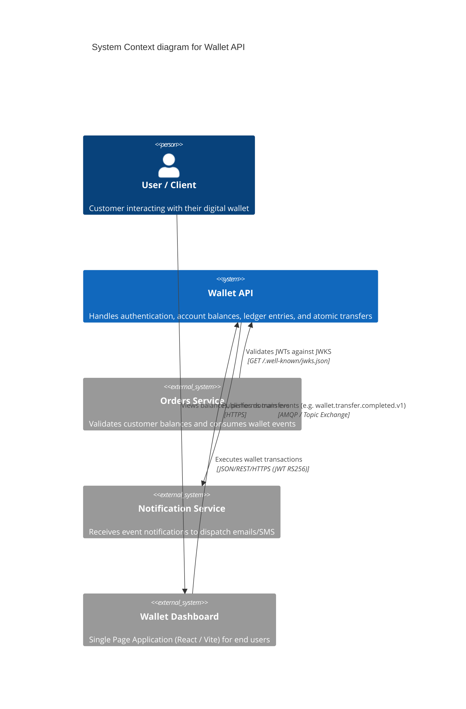
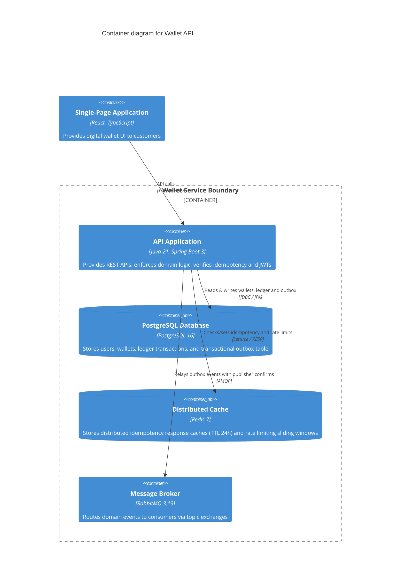

# Wallet API Architecture

## C4 Context Diagram



---

## C4 Container Diagram



---

## Hexagonal Package Structure

The codebase strictly adheres to Hexagonal Architecture (Ports and Adapters):

```
com.portfolio.wallet
├── domain
│   ├── event          # Domain events (e.g. TransferCompletedEvent)
│   ├── exception      # Pure domain exceptions (InsufficientFundsException, SameWalletTransferException)
│   └── model          # Core aggregates & value objects (Wallet, Money, Transaction)
├── application
│   ├── port
│   │   ├── input      # Use case interfaces (DepositUseCase, TransferMoneyUseCase)
│   │   └── output     # Outbound SPI ports (WalletRepositoryPort, OutboxRepositoryPort)
│   └── service        # Application use case orchestrators
├── infrastructure
│   ├── config         # Spring Security, Web MVC, OpenAPI beans
│   ├── messaging      # RabbitMQ configuration and OutboxRelayScheduler
│   ├── observability  # Actuator /health/live, /health/ready, /metrics
│   ├── persistence    # JPA entities, Flyway migrations, Spring Data repositories, adapters
│   ├── redis          # RedisTemplate, IdempotencyService, RateLimitingFilter
│   └── security       # RSA Key Provider, JWKS controller, JWT RS256 issuer, PasswordHasher
└── interfaces
    └── rest
        ├── advice     # RFC 7807 GlobalExceptionHandler
        ├── controller # REST controllers (AuthController, WalletQueryController, etc.)
        ├── dto        # Request and response contract DTOs
        ├── filter     # CorrelationIdFilter, IdempotencyFilter
        └── interceptor # IdempotencyInterceptor
```
